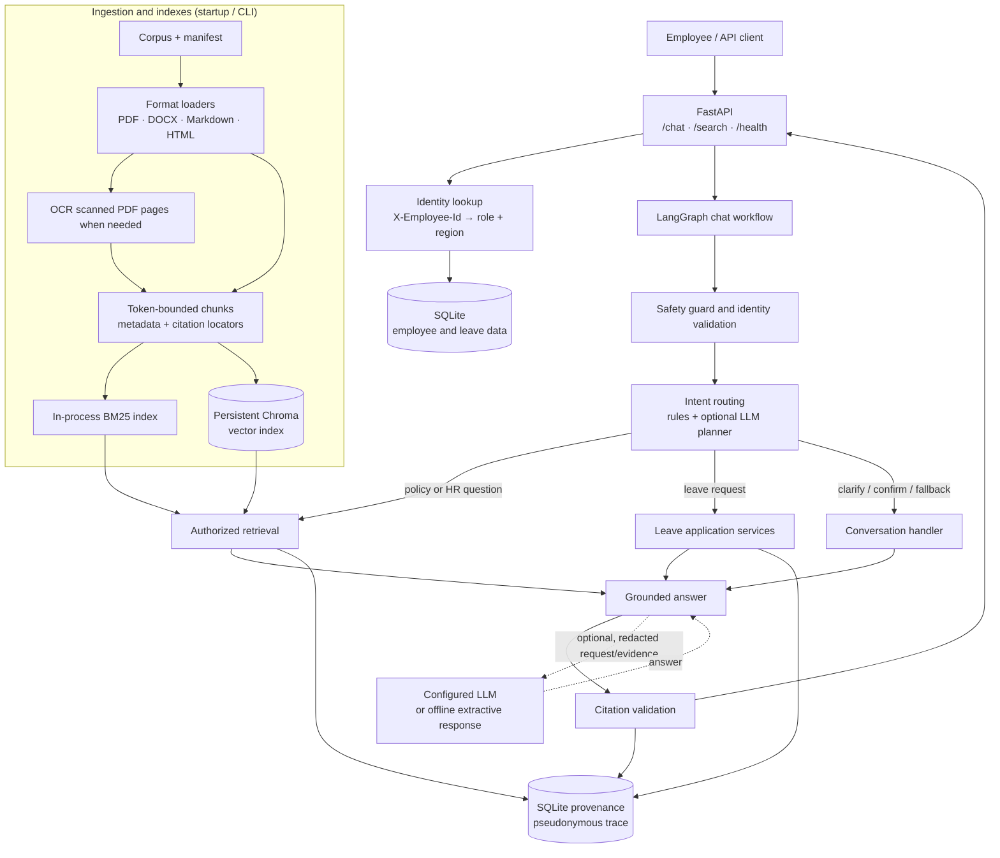
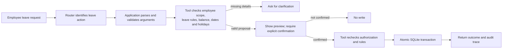

# Veltrix PeopleOps Assistant — Architecture

## At a glance

The service has two main paths: a document-ingestion path that prepares HR
policy evidence, and a request path that answers employee questions or handles
leave actions. FastAPI exposes the API, LangGraph coordinates chat, and
application code—not the language model—enforces authorization and write rules.

## Request flow

### Policy or HR question

1. The client calls `/chat` with an employee ID and message. FastAPI loads the
   employee's role and region from SQLite and binds the chat session to that
   employee. `/search` uses the same identity and retrieval protections but
   returns search results without the chat/answer-generation steps.
2. The chat workflow applies a safety guard and validates the identity context.
   It routes the request using deterministic application rules and, when
   configured, an LLM planner. The planner selects an action or search query;
   it does not receive retrieved document text or execute tools.
3. Retrieval filters documents by readability, role, region, metadata, and
   applicable date, and excludes superseded versions. Hybrid mode searches
   BM25 and Chroma, removes irrelevant candidates, then combines ranks with
   Reciprocal Rank Fusion. BM25-only mode is available as a fallback.
4. Policy precedence resolves applicable evidence by authority, regional
   specificity, and effective date while retaining genuine ties. The context
   builder caps corpus text sent to each answer-generation call at 3,000
   tokens.
5. The configured LLM generates a grounded answer (or offline mode returns
   matching source excerpts). Citation validation checks citations against the
   selected evidence before the response is returned.

### Leave action

The leave-tool layer is the authorization boundary: it checks the authenticated
requester and allowed target (including HR or manager scope) independently of
the planner. Preview operations do not mutate data. A confirmed write rechecks
the rules and updates the leave request and balance in one SQLite transaction.

## Ingestion and deployment

- The manifest defines which supported corpus files are ingested. Loaders
  extract text and tables from PDF, DOCX, Markdown, and HTML; scanned PDF pages
  can use Tesseract OCR. Ingestion validates paths and metadata, then creates
  token-bounded chunks carrying document metadata and citation locators.
- At application startup, the service ingests the configured corpus, builds
  the BM25 retriever, synchronizes Chroma, and then serves requests. The
  `veltrix-ingest` command is also available for ingestion workflows.
- Docker Compose runs the API container and mounts `./data` at `/app/data` for
  the corpus, SQLite database, and persistent vector index. The LLM provider
  is configurable; offline extractive responses are supported.

## Trust and audit boundaries

- Employee identity comes from the employee database, not claims in the chat
  message. Document access is filtered before evidence is used for answers.
- PII redaction is enabled by default for external model and embedding calls.
  The planner does not receive retrieved text; the answer model receives only
  authorized, bounded evidence.
- Provenance records ordered workflow events, evidence identifiers/hashes,
  and pseudonymous employee/session identifiers. It does not store raw
  messages, answers, or document text.

## Interview walkthrough

**Short version:** “I built a PeopleOps assistant that answers HR policy
questions with citations and can handle leave workflows. Documents are parsed
and chunked at startup into a lexical BM25 index and a persistent Chroma vector
index. FastAPI authenticates each employee, and a LangGraph workflow routes
requests. For policy answers, retrieval applies role, region, and date
authorization before hybrid search, resolves policy precedence, and gives the
model a small grounded context. For leave actions, application and tool code
enforce permissions, validate a preview, and require explicit confirmation
before an atomic SQLite write. PII redaction and pseudonymous provenance support
privacy and auditability.”

**Flow to draw or explain:** `Employee → FastAPI + identity → safety/routing →
authorized retrieval OR leave tool → grounded response / confirmed write →
citation validation + provenance`.

**Design point to emphasize:** The LLM helps interpret and phrase responses,
but it is not the security boundary. Authorization, policy applicability,
leave permissions, and confirmation are enforced by application code.
