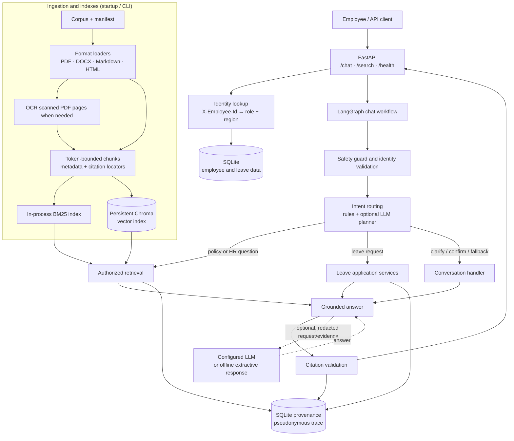
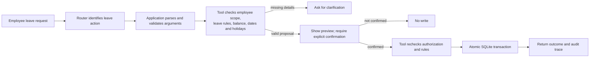
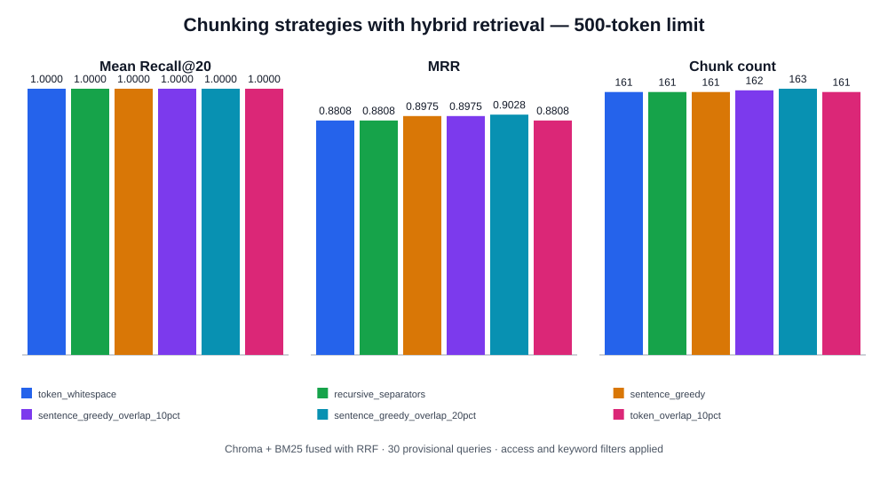
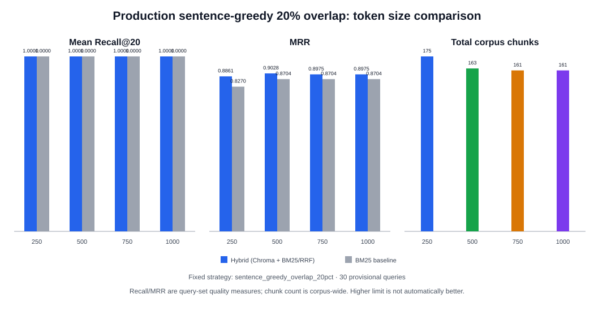

# Veltrix PeopleOps Assistant — Architecture

## At a glance

The service has two main paths: a document-ingestion path that prepares HR
policy evidence, and a request path that answers employee questions or handles
leave actions. FastAPI exposes the API, LangGraph coordinates chat, and
application code—not the language model—enforces authorization and write rules.

## Request flow

### Policy or HR question

1. The client calls `/chat` with an employee ID and message. FastAPI loads the
   employee's role and region from SQLite and binds the chat session to that
   employee. `/search` uses the same identity and retrieval protections but
   returns search results without the chat/answer-generation steps.
2. The chat workflow applies a safety guard and validates the identity context.
   It routes the request using deterministic application rules and, when
   configured, an LLM planner. The planner selects an action or search query;
   it does not receive retrieved document text or execute tools.
3. Retrieval filters documents by readability, role, region, metadata, and
   applicable date, and excludes superseded versions. Hybrid mode searches
   BM25 and Chroma, removes irrelevant candidates, then combines ranks with
   Reciprocal Rank Fusion. BM25-only mode is available as a fallback.
4. Policy precedence resolves applicable evidence by authority, regional
   specificity, and effective date while retaining genuine ties. The context
   builder caps corpus text sent to each answer-generation call at 3,000
   tokens.
5. The configured LLM generates a grounded answer (or offline mode returns
   matching source excerpts). Citation validation checks citations against the
   selected evidence before the response is returned.

### Leave action

The leave-tool layer is the authorization boundary: it checks the authenticated
requester and allowed target (including HR or manager scope) independently of
the planner. Preview operations do not mutate data. A confirmed write rechecks
the rules and updates the leave request and balance in one SQLite transaction.

## Ingestion and deployment

- The manifest defines which supported corpus files are ingested. Loaders
  extract text and tables from PDF, DOCX, Markdown, and HTML; scanned PDF pages
  can use Tesseract OCR. Ingestion validates paths and metadata, then creates
  token-bounded chunks carrying document metadata and citation locators.
- At application startup, the service ingests the configured corpus, builds
  the BM25 retriever, synchronizes Chroma, and then serves requests. The
  `veltrix-ingest` command is also available for ingestion workflows.
- Docker Compose runs the API container and mounts `./data` at `/app/data` for
  the corpus, SQLite database, and persistent vector index. The LLM provider
  is configurable; offline extractive responses are supported.

## Chunking benchmark (interview demo)

Production chunks each extracted section with a 500 `cl100k_base` token maximum
using greedy sentence packing with 20% token overlap. This retains neighboring
context while keeping chunks within the configured maximum. The offline
benchmark separately compared token/whitespace, recursive separators,
sentence-greedy with no overlap, 10% and 20% overlap, and fixed token windows
at 250, 500, 750, and 1,000-token limits. It used the 30-document corpus and
30 provisional labeled questions with production Chroma + local hashing
embeddings, BM25, RRF, and role/region/date and query-keyword filters. BM25-only
results are included as a baseline.

At 500 tokens, sentence-greedy with 20% overlap had the highest hybrid MRR of
the tested strategies, with Recall@20 tied at 1.0000. The overlap variants
also demonstrate the trade-off: at 500, 10% produced 162 chunks and MRR
0.8975; 20% produced 163 chunks and MRR 0.9028. Greedy sentence packing with
no overlap had MRR 0.8975.

| Strategy | Chunks @500 | Hybrid Recall@20 | Hybrid MRR |
|---|---:|---:|---:|
| Token/whitespace | 161 | 1.0000 | 0.8808 |
| Recursive separators | 161 | 1.0000 | 0.8808 |
| Sentence greedy, no overlap | 161 | 1.0000 | 0.8975 |
| Sentence greedy, 10% overlap | 162 | 1.0000 | 0.8975 |
| **Sentence greedy, 20% overlap (selected)** | **163** | **1.0000** | **0.9028** |
| Fixed token windows, 10% overlap | 161 | 1.0000 | 0.8808 |

### Selecting the token limit

| Token limit | Corpus chunks | Hybrid Recall@20 | Hybrid MRR | BM25 Recall@20 | BM25 MRR | Largest chunk |
|---:|---:|---:|---:|---:|---:|---:|
| 250 | 175 | 1.0000 | 0.8861 | 1.0000 | 0.8270 | 249 |
| 500 | 163 | 1.0000 | 0.9028 | 1.0000 | 0.8704 | 404 |
| 750 | 161 | 1.0000 | 0.8975 | 1.0000 | 0.8704 | 458 |
| 1,000 | 161 | 1.0000 | 0.8975 | 1.0000 | 0.8704 | 458 |

This size sweep holds the selected sentence-greedy 20%-overlap strategy
constant and uses the local 384-dimensional hashing embedder, Chroma cosine
search, BM25, and RRF (`rrf_k=60`), with role/region/date and keyword filters.
Both methods were evaluated at the app's top-20 chat limit. All limits
retrieved the labeled documents within top-20. The 500-token limit had the
highest hybrid MRR in this sweep. It reduced the corpus from 175 chunks at 250
tokens to 163; increasing to 750/1,000 saved only two additional chunks and
lowered MRR slightly. On this corpus, 500 is a reasonable quality/size
trade-off—not a universal optimum.

Across the 30 queries at 500 tokens, the selected strategy's returned hybrid
top-20 lists contained 485 chunks ranked by both methods, 101 BM25-only chunks,
and no vector-only chunks after the relevance and similarity filters. Hybrid
changed several ranks and improved aggregate MRR over BM25 alone. Results are
specific to local hashing embeddings and are not evidence for other embedding
providers or generated answer quality. The query labels are provisional, so
sentence-greedy 20% overlap is the best **measured candidate** in this run,
not a statistically conclusive winner.

**Interview explanation:** “We use a 500-token maximum as a practical bound,
not because it is a universal optimum. We compared different chunk sizes and
sentence-overlap settings using 30 HR questions with our local Chroma +
BM25/RRF hybrid retriever. Sentence-greedy chunking with 20% overlap gave the
best hybrid MRR at the configured 500-token limit while keeping Recall@20
perfect, so I selected it. The labels are provisional, so I would still review
them and validate on production-like queries before claiming it is universally
best.”

Regenerate the report and SVG with the command in
[README.md](./README.md); the JSON metrics are in
[chunking_benchmark.json](./benchmarks/chunking_benchmark.json).

## Trust and audit boundaries

- Employee identity comes from the employee database, not claims in the chat
  message. Document access is filtered before evidence is used for answers.
- PII redaction is enabled by default for external model and embedding calls.
  The planner does not receive retrieved text; the answer model receives only
  authorized, bounded evidence.
- Provenance records ordered workflow events, evidence identifiers/hashes,
  and pseudonymous employee/session identifiers. It does not store raw
  messages, answers, or document text.

## Interview walkthrough

**Short version:** “I built a PeopleOps assistant that answers HR policy
questions with citations and can handle leave workflows. Documents are parsed
and chunked at startup into a lexical BM25 index and a persistent Chroma vector
index. FastAPI authenticates each employee, and a LangGraph workflow routes
requests. For policy answers, retrieval applies role, region, and date
authorization before hybrid search, resolves policy precedence, and gives the
model a small grounded context. For leave actions, application and tool code
enforce permissions, validate a preview, and require explicit confirmation
before an atomic SQLite write. PII redaction and pseudonymous provenance support
privacy and auditability.”

**Flow to draw or explain:** `Employee → FastAPI + identity → safety/routing →
authorized retrieval OR leave tool → grounded response / confirmed write →
citation validation + provenance`.

**Design point to emphasize:** The LLM helps interpret and phrase responses,
but it is not the security boundary. Authorization, policy applicability,
leave permissions, and confirmation are enforced by application code.
