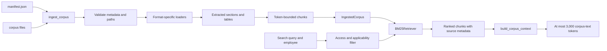

# Task 1: Ingestion and Retrieval — Technical Implementation

## Summary

Task 1 turns the assessment's manifest and HR document corpus into searchable,
source-aware chunks. The implementation automatically validates the manifest,
extracts content from PDF, DOCX, Markdown, and HTML files, extracts tables, and
uses Tesseract OCR when a PDF page has little or no extractable text. It
preserves manifest metadata and source locators with each chunk, performs local
BM25 retrieval, and includes utilities to construct a corpus context within
the assessment's 3,000-token limit.

The flow is:



In the current implementation, `POST /search` exercises ingestion, retrieval,
and basic document eligibility through a FastAPI endpoint. It is not the final
assessment `POST /chat` endpoint, and it does not call an LLM. The context
builder, citation data, and token-count logger are provided for the later chat
and LLM integration.

## Module-by-module

### `src/veltrix_assistant/ingestion/schemas.py`

This module defines the validated data passed between ingestion and retrieval:

- `DocumentMetadata` represents a manifest entry: `doc_id`, file, title,
  document type, regions, effective date, and access level. Pydantic rejects
  unknown fields, restricts the allowed document/access types, and prevents
  blank identifiers and titles.
- `ExtractedSection` holds extracted text with a page number and citation
  locator.
- `DocumentChunk` holds one piece of text with its stable chunk ID and the
  complete document metadata and locator.
- `IngestedCorpus` groups all successfully ingested documents and chunks.
- `RetrievedChunk` adds a BM25 score; `Citation` contains the response-facing
  document ID and locator.

The immutable models make it harder for later processing to accidentally
change the source metadata used for access checks or citations.

### `src/veltrix_assistant/ingestion/loaders.py`

`load_document(path)` chooses a parser from the file extension. Unsupported
extensions and files with no usable extracted text raise `IngestionError`
instead of silently producing empty content.

- **PDF:** `pdfplumber` extracts text page by page and attempts table
  extraction. Tables are serialized into pipe-separated rows so their cell
  values remain searchable. A page with fewer than 40 extracted characters
  triggers the OCR fallback.
- **OCR:** `_ocr_pdf_page` locates Tesseract from `TESSERACT_CMD` or `PATH`,
  renders the requested page with PyMuPDF, and runs Tesseract with a 90-second
  timeout. The temporary image is removed in a `finally` block. Missing
  Tesseract, subprocess errors, and timeouts surface as `IngestionError`.
- **DOCX:** `_iter_docx_blocks` walks paragraphs and tables in their original
  document order. `_load_docx` uses Word heading styles to start logical
  sections and serializes tables into searchable text.
- **Markdown:** `_load_markdown` splits content at Markdown heading lines and
  keeps the heading as that section's citation locator.
- **HTML:** `_load_html` reads headings, paragraphs, list items, and tables
  from the document body. Headings become locators; table cells are preserved
  in pipe-separated rows.
- **PDF heading and locator handling:** `_pdf_typographic_headings` uses
  PyMuPDF font-size and bold styling to identify likely title/heading lines.
  `_split_plain_text` also recognizes explicitly punctuated numbered headings
  and short all-uppercase lines, and carries the current heading across pages.
  A table marker is not treated as a heading, and unpunctuated numeric table
  values are not mistaken for numbered sections. When no heading applies, the
  section uses a page locator such as `p. 2`.

DOCX, Markdown, and HTML currently use `p. 1` as the fallback locator because
these loaders do not calculate printed page numbers. PDF sections use the
actual PDF page number.

### `src/veltrix_assistant/ingestion/pipeline.py`

`ingest_corpus(corpus_dir, manifest_path)` orchestrates a complete ingestion
run:

1. Resolve and check the corpus directory and manifest path.
2. Read the manifest as JSON and validate each entry with
   `DocumentMetadata`.
3. Reject an empty manifest and duplicate document IDs or file paths.
4. Confirm each manifest path is relative, remains inside the corpus, has a
   supported extension, and points to an existing file.
5. Ensure every supported file under the corpus directory is listed in the
   manifest. This catches accidental omissions when a corpus changes.
6. Load each document, chunk its extracted sections, and aggregate the results
   into an `IngestedCorpus`.

Manifest and filesystem problems raise `ManifestError`; failures in reading or
extracting document content raise `IngestionError`. Corpus facts are read from
the input files at runtime, not copied into code or prompts.

### `src/veltrix_assistant/ingestion/chunking.py`

`chunk_sections` splits each extracted section into chunks of at most 500
`cl100k_base` tokens by default. `_split_text` searches for a character
boundary whose text is within the token limit, then prefers a nearby space or
newline so chunks usually end at natural word boundaries. It checks the final
chunk's encoded size and raises an error if it cannot make a valid split.

Each chunk keeps the original document metadata, page, and locator. Its
deterministic SHA-256 ID is based on the document ID, page, locator, part
number, and chunk text. Identical source content therefore produces the same
chunk ID across ingestion runs.

The 500-token chunk size is a retrieval unit, not the LLM context limit. The
separate context builder enforces the 3,000-token per-call ceiling.

### `src/veltrix_assistant/retrieval/bm25.py`

`BM25Retriever` holds the ingested chunks and performs lexical retrieval
without a remote vector service:

1. Tokenize the query into case-folded word-like terms.
2. Apply the required `is_allowed(metadata)` predicate to every chunk before
   ranking.
3. Calculate term frequency and document frequency from only the allowed
   chunks.
4. Score matching chunks with BM25, using configurable `k1` and `b` parameters.
5. Sort by descending score, with chunk ID as a deterministic tie-breaker, and
   return up to `limit` matches.

Applying the predicate first means disallowed chunks are not included in the
retrieval results or passed to a later model-context builder. BM25 is lexical:
it does not infer that differently worded passages have the same meaning.

### `src/veltrix_assistant/retrieval/context.py`

This module prepares the corpus-text portion of a future LLM request:

- `build_corpus_context` appends whole chunks in retrieval order, measuring the
  joined text with `tiktoken`'s `cl100k_base` encoding. It skips any chunk
  whose addition would exceed the configured budget; the maximum permitted
  budget is 3,000 tokens.
- `CorpusContext` retains text blocks paired with their source citations.
  `formatted_text()` adds a `[doc_id | locator]` label to each block, and
  `citations` returns unique source references.
- `log_llm_corpus_tokens` logs the validated corpus-token count in a structured
  message suitable for calling immediately before an LLM request.

The token counter measures the joined corpus text, not system instructions,
conversation history, or source labels added by `formatted_text()`. The
assessment requires the actual LLM integration to call the logger for every
request and to ensure the counted corpus text is the text sent.

### `src/veltrix_assistant/api.py`

`create_app` constructs a FastAPI application and reads local settings from
`.env` or environment variables. During application startup, a background
lifespan task calls `ingest_corpus` and initializes `BM25Retriever`. The
`/health` endpoint returns 503 during loading or after an ingestion failure,
and 200 once the retriever is ready.

`POST /search` accepts a query, result limit, and optional reference date. It
requires `X-Employee-Id`, looks up the employee's region and role in the
configured SQLite `employees` table, and returns 401 when the ID is missing or
unknown. Before invoking BM25, it checks that each document:

- has an access level readable by the database-backed role;
- is global or includes the employee's database-backed region; and
- is effective on or before the requested reference date (or the configured
  current date).

The endpoint returns each result's `doc_id`, title, locator, text, and score.
It is a development/test endpoint for retrieval and does not implement the
assessment's full conversational contract.

### `src/veltrix_assistant/ingestion/cli.py`

`veltrix-ingest` is a command-line wrapper around `ingest_corpus`. It accepts
corpus and manifest paths (with environment-variable defaults) and an optional
chunk size, then reports only the status and document/chunk counts. It does
not print corpus contents.

### Tests

- `tests/test_ingestion.py` covers the supported formats, preservation of
  headings/tables/metadata, path-traversal rejection, missing manifest entries,
  unsupported formats, and OCR fallback for a textless PDF.
- `tests/test_retrieval.py` covers filtering before ranking, deterministic
  ordering, citation labels, the 3,000-token limit, Unicode chunk splitting,
  and token-count logging.
- `tests/test_api.py` exercises `/health` and `/search`, including role,
  region, effective-date, missing-ID, and unknown-ID behavior.

Run the focused suite with:

```powershell
uv run pytest
```

## Current boundaries and follow-up work

Task 1 provides automatic extraction, metadata-preserving chunks, local
retrieval, citation metadata, and token-budget helpers. Before the final
assessment submission, the chat implementation still needs to integrate the
context builder and token logger with every LLM call and enforce the complete
document precedence/conflict rules, upcoming-change behavior, final response
routes, and citation selection. The test API's eligibility filter handles
role, region, and effective date, but it does not select a winning document
under the full precedence rules.
